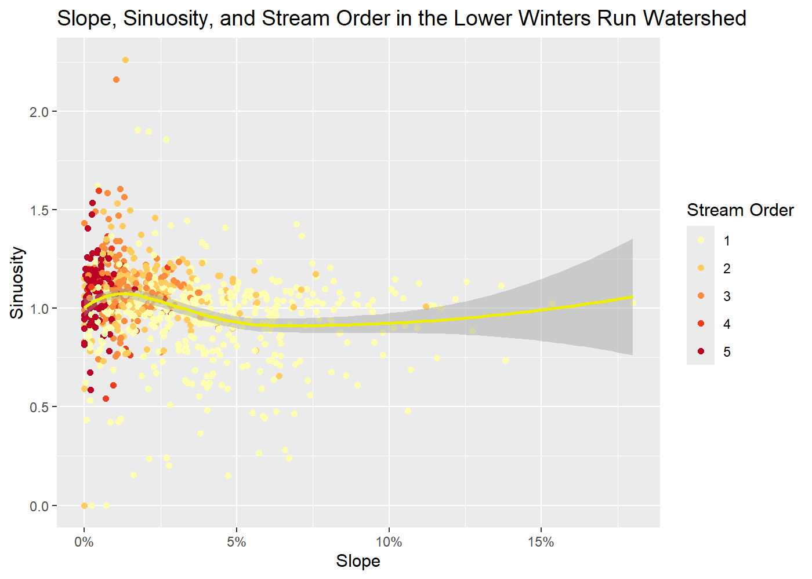
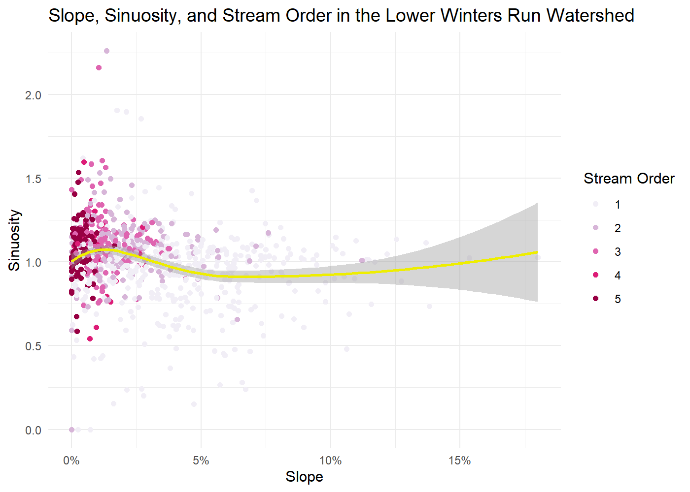
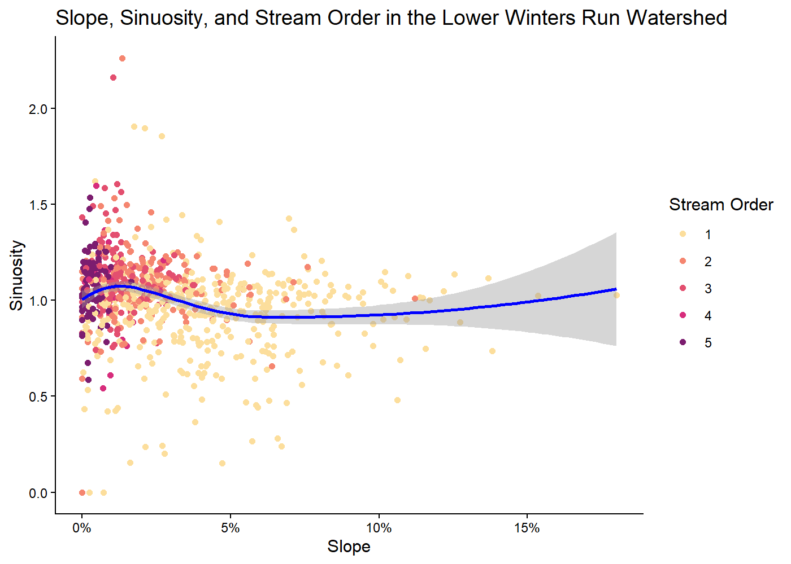
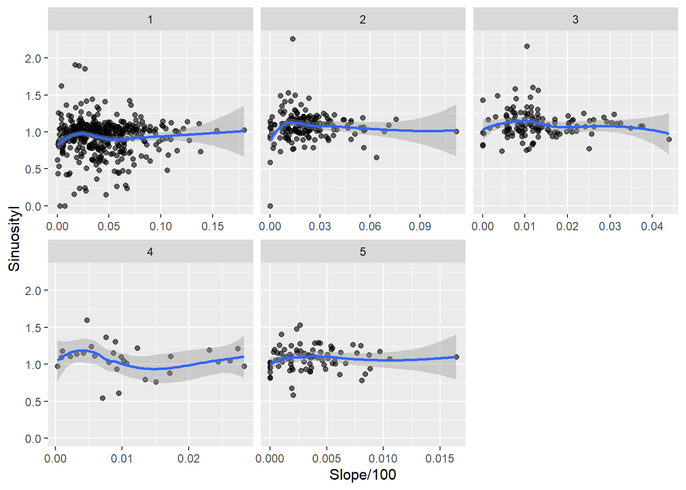
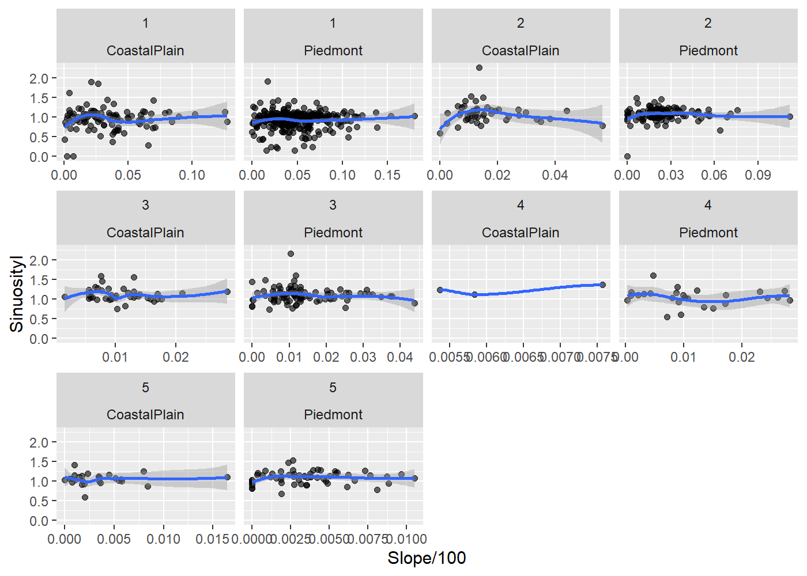
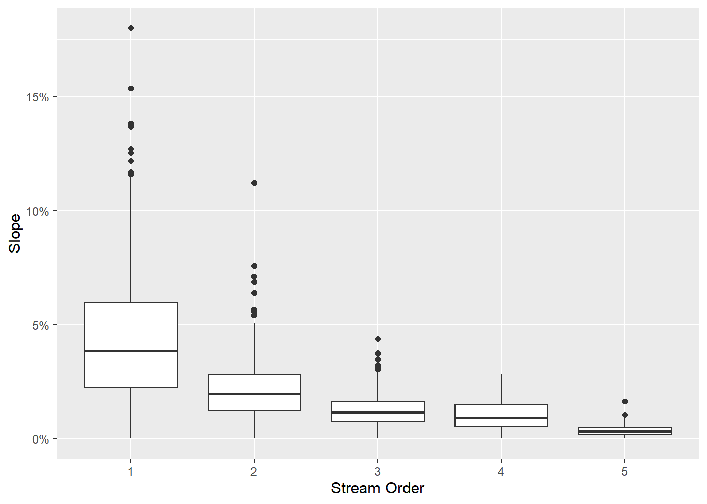
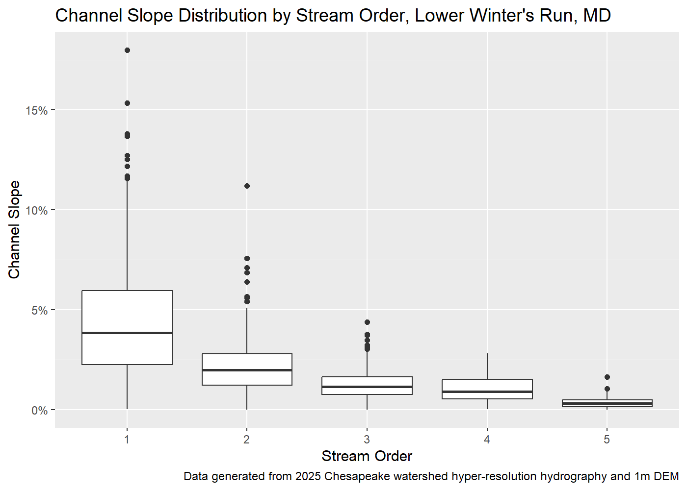
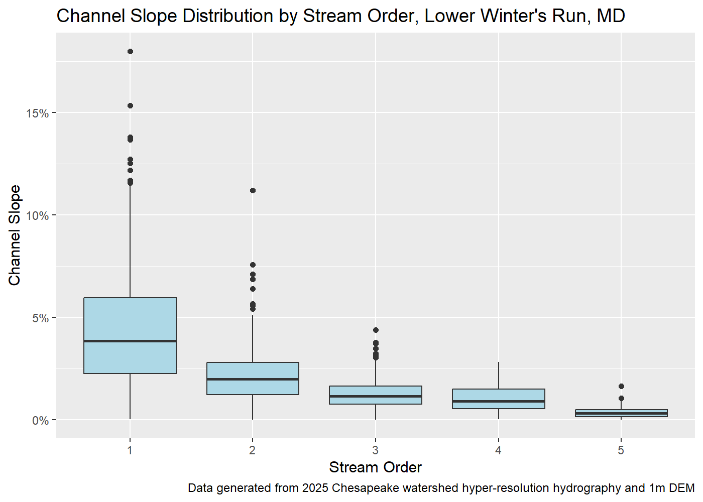
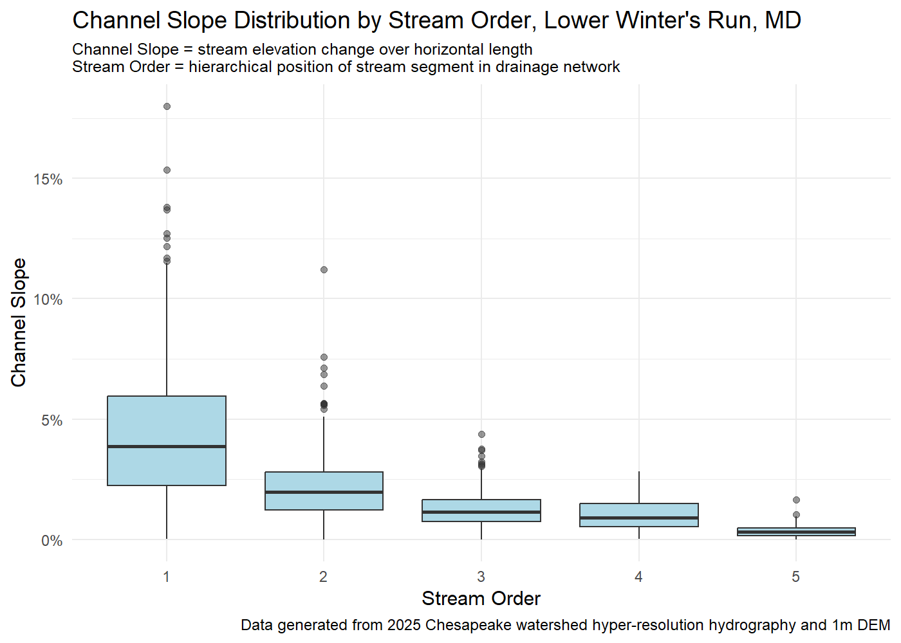
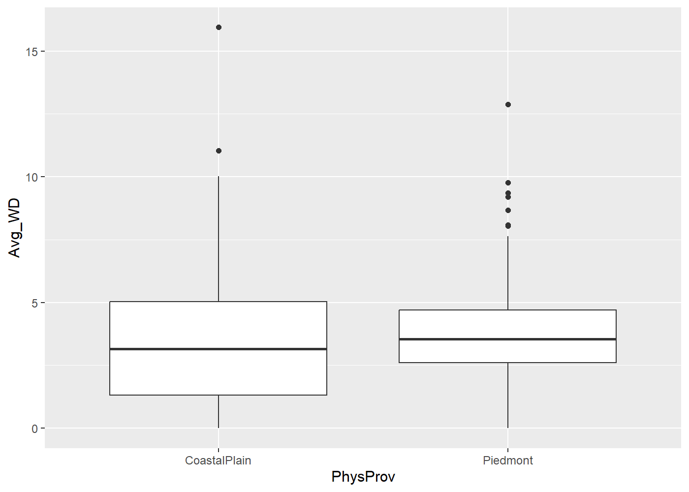

# Sketches
Your name

``` r
library(ggplot2)
library(sf)
```

    Linking to GEOS 3.13.1, GDAL 3.11.4, PROJ 9.7.0; sf_use_s2() is TRUE

``` r
Low_Wint_Run <- st_read(
  "../data/LowerWintersRun_StreamData_v3.shp")
```

    Reading layer `LowerWintersRun_StreamData_v3' from data source 
      `C:\Users\Leope\Documents\midterm\data\LowerWintersRun_StreamData_v3.shp' 
      using driver `ESRI Shapefile'
    Simple feature collection with 832 features and 37 fields
    Geometry type: MULTILINESTRING
    Dimension:     XY
    Bounding box:  xmin: 1659562 ymin: 1995743 xmax: 1667206 ymax: 2007062
    Projected CRS: USA_Contiguous_Albers_Equal_Area_Conic_USGS_version

``` r
Low_Wint_Run_data <- Low_Wint_Run|>
  dplyr::select(ID, SinuosityI, PhysProv,Slope, strOrder,Avg_WD)

StreamData <- Low_Wint_Run_data |>
  dplyr::filter(SinuosityI <= 200)

StreamData$strOrder<-as.factor(StreamData$strOrder)
# 
```

``` r
#scatterplot

ggplot(StreamData,aes(x=Slope/100,y=SinuosityI))+
  geom_point(aes(colour=strOrder))+
  geom_smooth(colour="yellow2")+
  scale_colour_brewer(palette="YlOrRd")+
  labs(y="Sinuosity",x="Slope",title = "Slope, Sinuosity, and Stream Order in the Lower Winters Run Watershed", colour="Stream Order")+
  scale_x_continuous(labels = scales::label_percent())
```

    `geom_smooth()` using method = 'loess' and formula = 'y ~ x'



``` r
#doing sequential pallette for stream order

#make legend title

ggplot(StreamData,aes(x=Slope/100,y=SinuosityI))+
  geom_point(aes(colour=strOrder))+
  geom_smooth(colour="yellow2")+
  scale_colour_brewer(palette="PuRd")+
  labs(y="Sinuosity",x="Slope",title = "Slope, Sinuosity, and Stream Order in the Lower Winters Run Watershed", colour="Stream Order")+
  scale_x_continuous(labels = scales::label_percent())+
  theme_minimal()
```

    `geom_smooth()` using method = 'loess' and formula = 'y ~ x'



``` r
ggplot(StreamData,aes(x=Slope/100,y=SinuosityI))+
  geom_point(aes(colour=strOrder))+
  geom_smooth(colour="blue")+
  scale_colour_manual(values=rcartocolor::carto_pal(5,name ="SunsetDark"))+
  labs(y="Sinuosity",x="Slope",title = "Slope, Sinuosity, and Stream Order in the Lower Winters Run Watershed", colour="Stream Order")+
  scale_x_continuous(labels = scales::label_percent())+
  theme_classic()
```

    `geom_smooth()` using method = 'loess' and formula = 'y ~ x'



``` r
#could look at slope vs sinuosity scatterplots broken up by stream order, may show different patterns and be good for faceting, considering whether or not to use all stream order categories (1-5) or breaking up into less more inclusive categories (i.e. 1st order and not 1st order, or, 1st+2nd and 3rd-5th) and looking at facets of the relationship between slope and sinuosity with each facet being different stream orders


ggplot(StreamData,aes(x=Slope/100,y=SinuosityI))+
  geom_point(aes(colour=strOrder))+
  geom_smooth(colour="yellow2")+
  scale_colour_brewer(palette="YlOrRd")+
  labs(y="Sinuosity",x="Slope",title = "Slope, Sinuosity, and Stream Order in the Lower Winters Run Watershed", colour="Stream Order")+
  scale_x_continuous(labels = scales::label_percent())
```

    `geom_smooth()` using method = 'loess' and formula = 'y ~ x'


``` r
ggplot(StreamData, aes(x = Slope/100, y = SinuosityI)) +
  geom_point(alpha = 0.6) +
  geom_smooth() +
  facet_wrap(~ strOrder, scales="free_x")
```

    `geom_smooth()` using method = 'loess' and formula = 'y ~ x'



``` r
#facets of relationship by stream order is also interesting but I think having them together on a single scale in a single graph tells a similar story with less visual information, so going with non-faceted graph


ggplot(StreamData, aes(x = Slope/100, y = SinuosityI)) +
  geom_point(alpha = 0.6) +
  geom_smooth() +
  facet_wrap(~ strOrder~PhysProv, scales="free_x")
```

    `geom_smooth()` using method = 'loess' and formula = 'y ~ x'

    Warning in simpleLoess(y, x, w, span, degree = degree, parametric = parametric,
    : span too small.  fewer data values than degrees of freedom.

    Warning in simpleLoess(y, x, w, span, degree = degree, parametric = parametric,
    : pseudoinverse used at 0.0053537

    Warning in simpleLoess(y, x, w, span, degree = degree, parametric = parametric,
    : neighborhood radius 0.00048539

    Warning in simpleLoess(y, x, w, span, degree = degree, parametric = parametric,
    : reciprocal condition number 0

    Warning in simpleLoess(y, x, w, span, degree = degree, parametric = parametric,
    : There are other near singularities as well. 3.0368e-06

    Warning in predLoess(object$y, object$x, newx = if (is.null(newdata)) object$x
    else if (is.data.frame(newdata))
    as.matrix(model.frame(delete.response(terms(object)), : span too small.  fewer
    data values than degrees of freedom.

    Warning in predLoess(object$y, object$x, newx = if (is.null(newdata)) object$x
    else if (is.data.frame(newdata))
    as.matrix(model.frame(delete.response(terms(object)), : pseudoinverse used at
    0.0053537

    Warning in predLoess(object$y, object$x, newx = if (is.null(newdata)) object$x
    else if (is.data.frame(newdata))
    as.matrix(model.frame(delete.response(terms(object)), : neighborhood radius
    0.00048539

    Warning in predLoess(object$y, object$x, newx = if (is.null(newdata)) object$x
    else if (is.data.frame(newdata))
    as.matrix(model.frame(delete.response(terms(object)), : reciprocal condition
    number 0

    Warning in predLoess(object$y, object$x, newx = if (is.null(newdata)) object$x
    else if (is.data.frame(newdata))
    as.matrix(model.frame(delete.response(terms(object)), : There are other near
    singularities as well. 3.0368e-06

    Warning in max(ids, na.rm = TRUE): no non-missing arguments to max; returning
    -Inf



``` r
#doing facets by both stream order and phys province is interesting but some categories have very sparse data and its alot of info to take in so I am going to skip
```

``` r
#slope boxplot

#raw plot, made slope %
ggplot(StreamData,aes(x=strOrder,y=Slope/100))+
         geom_boxplot()+ labs(x="Stream Order", y="Slope")+
  scale_y_continuous(labels = scales::label_percent())
```



``` r
ggplot(StreamData,aes(x=strOrder,y=Slope/100))+
         geom_boxplot()+ labs(x="Stream Order", y="Slope")+
  scale_y_continuous(labels = scales::label_percent())+
  labs(title="Channel Slope Distribution by Stream Order, Lower Winter's Run, MD",y="Channel Slope", caption = "Data generated from 2025 Chesapeake watershed hyper-resolution hydrography and 1m DEM")
```



``` r
#going for more descriptive labels, intending for scientific audience

ggplot(StreamData,aes(x=strOrder,y=Slope/100))+
         geom_boxplot(fill="lightblue")+ labs(x="Stream Order", y="Slope")+
  scale_y_continuous(labels = scales::label_percent())+
  labs(title="Channel Slope Distribution by Stream Order, Lower Winter's Run, MD",y="Channel Slope", caption = "Data generated from 2025 Chesapeake watershed hyper-resolution hydrography and 1m DEM")
```



``` r
#used minimal theme to reduce visual clutter, made outliers have some transparency so they don't appear to heavy and obscure each other

ggplot(StreamData,aes(x=strOrder,y=Slope/100))+
         geom_boxplot(fill="lightblue", outlier.alpha =0.5 )+ 
  labs(x="Stream Order", y="Slope")+
  scale_y_continuous(labels = scales::label_percent())+
  labs(title="Channel Slope Distribution by Stream Order, Lower Winter's Run, MD",y="Channel Slope", subtitle = "Channel Slope = stream elevation change over horizontal length
Stream Order = hierarchical position of stream segment in drainage network", caption = "Data generated from 2025 Chesapeake watershed hyper-resolution hydrography and 1m DEM")+
  theme_minimal()+
  theme(plot.subtitle = element_text(size = 9))
```



``` r
#Table showing % of streams by phys province and stream order, I think the table is more effective here than a visualization

#need to clean up table format, spacing, and make shares a %

StreamData_cats <- StreamData|>
  dplyr::select(PhysProv, strOrder)
StreamData_cats_shares <-StreamData_cats|>
    dplyr::group_by(PhysProv,strOrder) |>
    dplyr::summarise(n = dplyr::n())|>
    dplyr::mutate(share = n / sum(n))
```

    `summarise()` has regrouped the output.
    ℹ Summaries were computed grouped by PhysProv and strOrder.
    ℹ Output is grouped by PhysProv.
    ℹ Use `summarise(.groups = "drop_last")` to silence this message.
    ℹ Use `summarise(.by = c(PhysProv, strOrder))` for per-operation grouping
      (`?dplyr::dplyr_by`) instead.

``` r
StreamData_cats_shares$share <- StreamData_cats_shares$share*100

StreamData_cats_shares$share <- round(StreamData_cats_shares$share,2)

StreamData_cats_shares$share <- paste0(StreamData_cats_shares$share, "%")

knitr::kable(
    StreamData_cats_shares|>
      sf::st_drop_geometry()|>
      dplyr::select(PhysProv,strOrder,share),
    align = "lcr",
    col.names = c(
        "Physiographic Province",
        "Stream Order","Share"),
    caption = "Share of Stream Segements by Physiographic Province and Stream Order, Lower Winter's Run Watershed",hline_after = NULL,
    digits = 2)
```

| Physiographic Province | Stream Order |  Share |
|:-----------------------|:------------:|-------:|
| CoastalPlain           |      1       |  48.2% |
| CoastalPlain           |      2       | 21.17% |
| CoastalPlain           |      3       | 17.57% |
| CoastalPlain           |      4       |  1.35% |
| CoastalPlain           |      5       | 11.71% |
| Piedmont               |      1       | 50.57% |
| Piedmont               |      2       | 20.36% |
| Piedmont               |      3       | 15.27% |
| Piedmont               |      4       |  4.27% |
| Piedmont               |      5       |  9.52% |

Share of Stream Segements by Physiographic Province and Stream Order,
Lower Winter’s Run Watershed

``` r
#round share to 2 digits and make percentage

knitr::kable(
    StreamData_cats_shares|>
      sf::st_drop_geometry()|>
      dplyr::select(PhysProv,strOrder,share),
    align = "lcr",
    col.names = c(
        "Phys. Province &nbsp;",
        "Stream Ord.&nbsp;","Share"),
    caption = "Share of Stream Segments by Physiographic Province and Stream Order, Lower Winter's Run Watershed",
    digits = 2)
```

| Phys. Province   | Stream Ord.  |  Share |
|:-----------------|:------------:|-------:|
| CoastalPlain     |      1       |  48.2% |
| CoastalPlain     |      2       | 21.17% |
| CoastalPlain     |      3       | 17.57% |
| CoastalPlain     |      4       |  1.35% |
| CoastalPlain     |      5       | 11.71% |
| Piedmont         |      1       | 50.57% |
| Piedmont         |      2       | 20.36% |
| Piedmont         |      3       | 15.27% |
| Piedmont         |      4       |  4.27% |
| Piedmont         |      5       |  9.52% |

Share of Stream Segments by Physiographic Province and Stream Order,
Lower Winter’s Run Watershed

``` r
#had to look up spacing column spacing approaches, found &nbsp; method, also opted to abbreviate colunmn titles some, doing center align on stream order to prevent crowding with other columns

#key takeaways from table: 1st order streams make up majority of streams in both provinces, similar shares of stream order in each province, but piedmont has slightly larger share of 1st order streams and CP has slightly larger share of larger order streams - makes sense - need to explain somewhere
```

``` r
ggplot(StreamData,aes(x=PhysProv,y=Avg_WD))+
         geom_boxplot()
```


